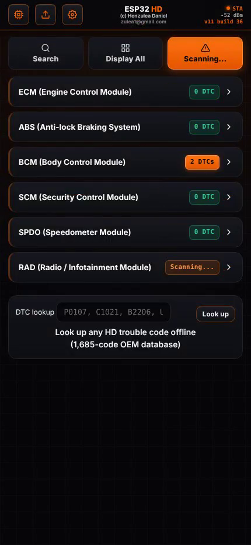
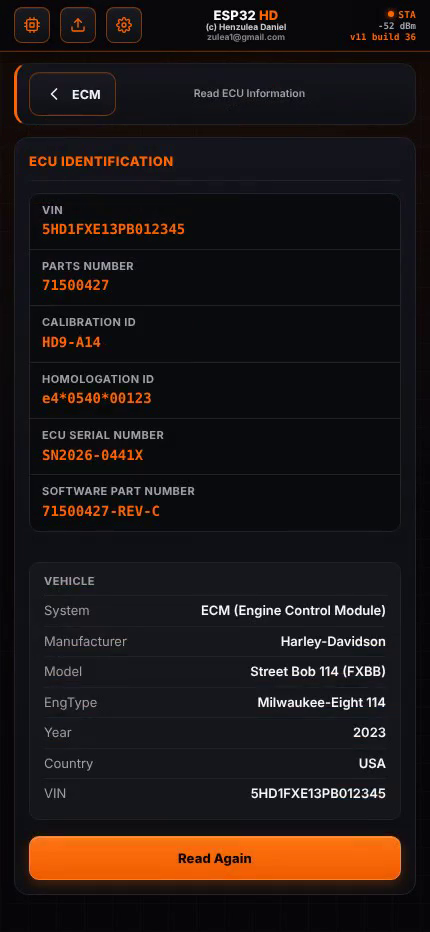
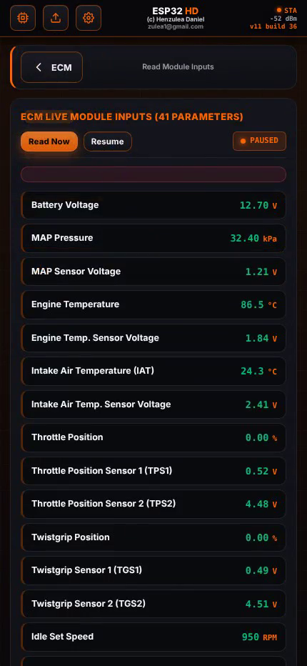
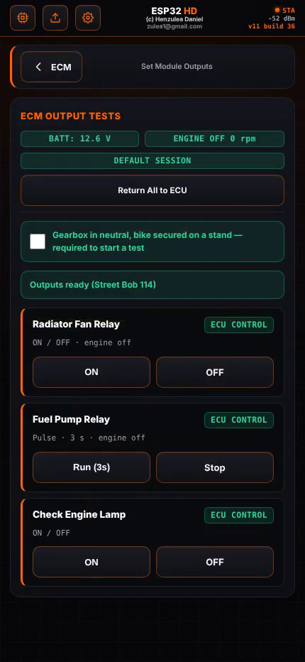
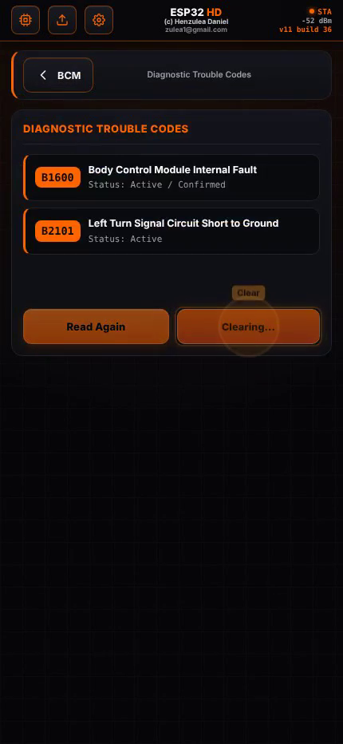
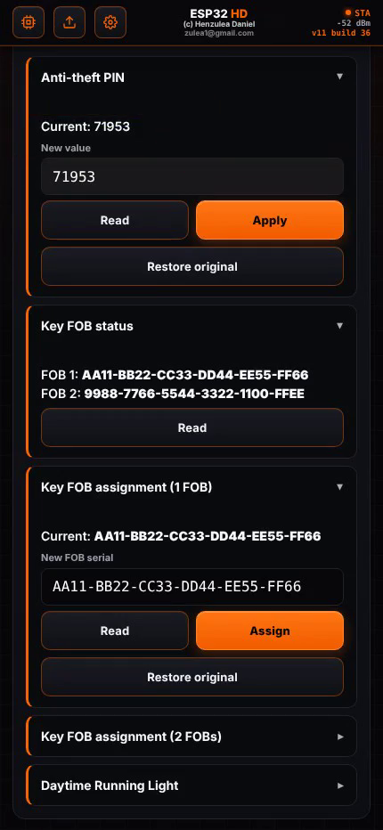
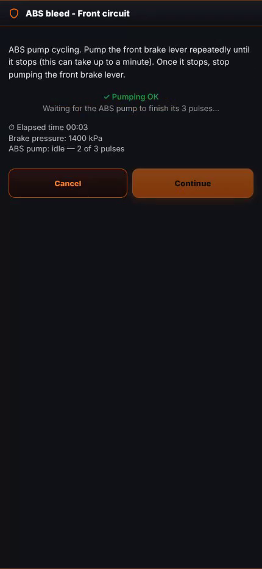
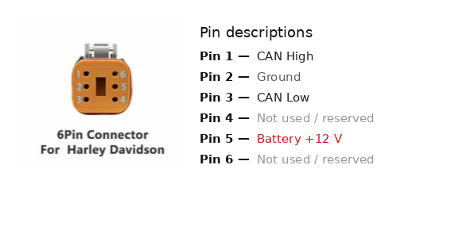

# ESP32-HD

**An open-source UDS/CAN diagnostic service tester for Harley-Davidson motorcycles — full dealer-tool-grade diagnostics, on a $10 microcontroller.**

ESP32-HD talks native **UDS (ISO 14229)** over **CAN-TP (ISO 15765-2)**, directly on the bike's 500 kbps HS-CAN bus, to every module HD puts on it: ECM, ABS, BCM, SCM, SPDO, RAD, and the handlebar control modules. No laptop, no dongle, no subscription — just an ESP32, a CAN transceiver, and a browser.

> ⚠️ **This talks to live vehicle control modules and can command real actuators (ABS pump/valves, relays, fuel pump).** Read the [Safety](#safety) section before connecting it to a running vehicle.

---

## Why

Factory and aftermarket HD scan tools are expensive, licensed, and closed. ESP32-HD is the opposite on every axis: it's a few dollars of hardware, the full firmware and web UI source are published under the GPL, and it runs as a self-hosted Wi-Fi access point — connect any phone or laptop to it and open a browser, no app install required.

## Features

| Area | What it does |
|---|---|
| **Module scan** | Auto-detects every responding module on the bus (0x7DF broadcast) and shows live DTC counts per module |
| **DTCs** | Read and clear diagnostic trouble codes per module, plus a fully offline **1,685-code lookup database** — no internet needed at the bike |
| **ECU identification** | VIN, calibration ID, part numbers, homologation ID, serial number — decoded per module, with VIN-based vehicle info (model, engine, year) |
| **Live data** | Real-time module inputs — up to 41 live parameters on the ECM alone (sensors, switches, session/security state) |
| **Actuator tests** | Command outputs directly — fans, relays, fuel pump, lamps — for bench and functional testing |
| **Special functions** | Per-module service routines: idle relearn, TPS reset, speedo calibration, TPMS sensor ID/status, security-module pairing |
| **BCM security** | Read/write the Anti-theft PIN and assign Key FOBs (1 or 2), with the real seed/key security-access handshake |
| **Guided ABS bleed** | A real, step-by-step hydraulic brake-bleed procedure (front & rear circuits) — live pump/solenoid commands, live brake-pressure feedback, and automatic pump-cycle detection |
| **OTA updates** | Flash new firmware from the browser after the first USB flash — no cables, no disassembly |

## Screenshots

| | |
|---|---|
|  Module auto-scan with live DTC counts |  ECU identification + decoded vehicle info |
|  Live module inputs (41 ECM parameters) |  Actuator/output bench tests |
|  Diagnostic trouble codes, read & clear |  Anti-theft PIN write + Key FOB assignment |
|  Guided ABS bleed procedure with live pump-pulse tracking | |

## Demo video

https://github.com/user-attachments/assets/7099aa79-5f46-4a3b-8315-5d33cf9b22ee

## Hardware

- **MCU**: ESP32 (dual-core Xtensa LX6 @ 240 MHz), 4 MB flash
- **CAN PHY interface**: a regular CAN transceiver (e.g. TJA1050/MCP2551-class, 3.3 V/5 V) on the ESP32's built-in TWAI/CAN controller. **TJA1043** (or compatible) is supported as a **2nd PHY option**, adding standby/enable/fault-monitoring control on top of plain TX/RX.
- **Bus**: 500 kbps High-Speed CAN (ISO 11898-2), tapped at the bike's diagnostic connector

Note: the STB/EN/ERR_N pins below are **optional** — only needed if you use the TJA1043 (2nd PHY option). A plain transceiver only needs the TX/RX pins.

| Signal | ESP32 pin |
|---|---|
| CAN TX → transceiver TXD | GPIO 22 |
| CAN RX ← transceiver RXD | GPIO 21 |
| Transceiver STB (standby, active HIGH = normal) — *optional, TJA1043 (2nd PHY option) only* | GPIO 19 |
| Transceiver EN (active HIGH = normal) — *optional, TJA1043 (2nd PHY option) only* | GPIO 18 |
| Transceiver ERR_N (active LOW fault) — *optional, TJA1043 (2nd PHY option) only* | GPIO 33 |
| CAN activity LED | GPIO 2 |
| System status LED | GPIO 15 |
| Safe-boot / recovery button (pull LOW at power-up) | GPIO 4 |

All of the GPIO pins above can be reassigned from the web UI's Settings page and are stored in NVS — the table shows the **defaults** the firmware falls back to after a full NVM/settings reset, not fixed pins.

Any ESP32 dev board + a regular CAN transceiver breakout (TJA1050, MCP2551, or similar) wired to TX/RX above will work. A TJA1043 (or similar) breakout is also supported as a 2nd PHY option, with its extra STB/EN/ERR_N pins (optional, not required by a plain transceiver) wired as shown for standby control and fault monitoring.

### The bike's 6-pin connector



This is the bike's own native 6-pin connector (not an OBD-II port) — usually a black weatherproof plug tucked under the seat or side cover, near the battery. This is where you tap into the HS-CAN bus with the CAN transceiver above.

**Verify before building a cable**: pin numbering, wire colors, and connector shell style can vary by model/year. Cross-check against your bike's own wiring diagram, or probe the connector with a multimeter/scope (CAN H and L sit around 2.5 V idle, moving in opposite directions when there's bus traffic) before wiring it up.

## Building & flashing

Built with [PlatformIO](https://platformio.org/).

```bash
git clone <this-repo>
cd esp32-hd
pio run -e esp32_hd -t upload      # build + flash the full diagnostic app over USB
```

The web UI (`web_src/`) is packaged into the firmware image automatically by a PlatformIO pre-build hook (`build_web_ui.py`) — no separate web build step.

A minimal safe-boot/recovery firmware (`env:safeboot_hd`) also ships in the factory partition, so a bad OTA update can never brick the device — see the comments in `platformio.ini` for how to flash it (one-time, over USB).

### Flashing a totally new/blank chip

For a brand-new ESP32 (or to force a guaranteed-clean re-flash), use the `env:flash_full` target. It fully erases the chip, builds **both** firmwares (main app + safe-boot/recovery), and writes everything — bootloader, partition table, boot_app0, the safe-boot firmware (factory slot), and the main app (ota_0 slot) — in one command:

```bash
pio run -e flash_full -t fullflash
pio run -e flash_full -t fullflash --upload-port /dev/ttyUSB0   # Linux/macOS, if autodetect picks the wrong port
pio run -e flash_full -t fullflash --upload-port COM5           # Windows, if autodetect picks the wrong port
```

**Warning**: this erases NVS too, so all saved settings (Wi-Fi SSID/password, CAN bitrate, GPIO pin assignments, etc.) are wiped back to firmware defaults. For routine app-only updates where you want to keep your settings, use the normal `pio run -e esp32_hd -t upload` above instead — it never touches NVS or the factory partition. See `flash_full.py` for exactly what it does, including the manual `esptool` command sequence if the custom target doesn't run on your PlatformIO Core version.

### Using it

1. Power the board up — it starts a Wi-Fi access point (`ESP-32-HD` by default).
2. Connect your phone/laptop to it and open `http://192.168.4.1` (or whatever address your client gets).
3. Tap **Search** (or **Display All**) to find modules on the bus, pick one, and start diagnosing.

## Project status

Actively developed. The UDS/CAN transport layer, module scanning, DTC read/clear, live data, actuator tests, ECU identification, and the ABS guided-bleed and BCM security procedures are implemented and working against real hardware. Contributions — new module coverage, additional special functions, bug reports from real bikes — are welcome.

Currently only CAN/UDS (ISO 14229 over ISO 15765-2) is implemented. **J1850 VPW** support, using a simple hardware interface, is coming very soon, to cover older HD modules that predate the CAN bus. **ECM map read/write for ECU tuning** is also planned for a future release.

## Safety

This tool can energize ABS pump motors and solenoids, command relays and fuel pumps, and write security-relevant data (PINs, key FOB assignments) to vehicle modules. Only use it with the vehicle on a stand, wheels off the ground, by someone who understands what each function does. The guided procedures include built-in interlocks (e.g. refusing to actuate ABS valves while a wheel is turning), but they are not a substitute for following the on-screen safety checklist or for basic shop safety practice.

## License

GPL-3.0-or-later — see [`LICENSE`](LICENSE). Copyright © 2026 Henzulea Daniel email: zulea1@gmail.com
